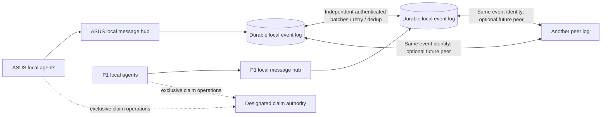

# Local communication and peer message replication

Implementation status: design and isolated candidates, not a deployed mesh.
Owner: `codex-p1-agenthub-reconcile`. Assessment: 2026-10-16 UTC.
The [off-site hosting proposal](reliability-and-hosting-plan.md) remains the
longer-term placement plan; this work does not provision paid infrastructure.

## Required behavior

Each participating machine must support intentional local agent communication
without probing another machine, waiting for its outbox lock, or requiring the
remote hub, Cloudflare, Headscale control server or UDM to be reachable. Local
send/read/inbox/watch and direct/group channels must remain usable during a peer
partition. Local acceptance, replication progress and global claims are separate
results. Local storage exhaustion or a stopped local service must fail visibly;
finite hardware cannot promise availability under every local failure.

ASUS and dtm-p1gen7 are equal **message capture and replication** targets with
distinct identities. They must not independently grant the same globally
exclusive resource claim during a partition. Existing single-authority claims
remain explicitly pending when that authority is unreachable. Host-scoped claim
semantics require a separately tested namespace policy before enabling them.

## Observed starting state

- All five current authoritative client routes name ASUS. Alternate paths to
  one host do not provide host redundancy.
- P1 has native Redis/PostgreSQL services and a running older HTTP service on
  loopback port 18400. One bounded health request timed out. Running/listening
  is not readiness evidence. Its service configuration and binary differ from
  the current user installation.
- Existing watchdog/routing policy rejects P1 as an authoritative hub and
  forbids treating port 18400 as an ordinary candidate. Deployment must update
  these consumers coherently after qualifying the new behavior.
- Cloud synchronization is a separate star topology, with local-origin export,
  expiring deduplication and Redis-stream catch-up. The approximately 100,000-row
  stream may trim events before an offline peer catches up. It cannot establish
  arbitrary-delay peer recovery by configuration alone.
- A shared per-user client journal can be locked across remote replay. Local
  communication must not open, drain, rotate or wait for that unrelated journal.
  Existing retained requests and their original destination must remain intact.

## Implementation contract

1. Add an explicit local-message client mode. Preserve the original remote
   authority configuration for claim operations. Opt-in local mode must be
   visible in health, not masquerade as a synchronized fleet-wide view.
2. Commit each accepted mesh message to a durable local event log before
   acknowledging capture. Preserve immutable event identity, canonical payload
   digest and original origin across forwarding. UUID/payload collisions are
   errors; duplicate retries return the existing receipt.
3. Serialize sequence allocation with transaction commit ordering. A bare
   sequence allocated by overlapping transactions can commit out of order and
   cause a cursor to skip a late event permanently.
4. Project durable events into local message/channel streams and notifications
   idempotently. Retain unprojected events for repair after restart. A partially
   applied Redis script with uncertain effects is an explicit repair hold, not
   an automatic blind re-execution or a successful projection.
5. Maintain durable, compare-and-swap peer cursors. Advance only after an exact
   authenticated destination receipt proves durable commit. Retain backlog;
   never silently advance across a missing range. Bound storage with visible
   backpressure rather than trimming unacknowledged work.
6. Run each peer independently with bounded batches, request deadlines and
   jittered retry. Never hold a local journal/database lock across network I/O.
   One unavailable peer or a presence/Cloud backend failure must not stop local
   sends or synchronization with another reachable peer.
7. Forward eligible foreign-origin events so a three-node mesh can relay them.
   Permanent identity/digest receipts prevent loops. Preserve `no-offsite`
   restrictions; exclusions and blocked backlog must be observable.
8. Use separately provisioned peer credentials, restricted to a named mesh
   scope and expected source/destination identities. Do not reuse Cloudflare
   publisher credentials or weaken the existing client API's authentication.
9. Keep direct and group channel projection explicit. Do not claim complete
   message synchronization while only the main broadcast stream is covered.
   Lease/arbitration state and group membership are not ordinary message events.

## Validation and deployment gates

Use disposable stores and owned processes. Required detecting tests include:

- Bidirectional simultaneous sends, concurrent duplicate delivery and conflicting
  reuse of an event UUID; one durable event and recipient notification per hub.
- Lost destination response, process restart and crashes before/after durable
  commit, Redis projection and cursor advancement.
- Long partitions and backlog beyond the old stream/dedup horizons; no silent
  gap or dependence on current Redis retention.
- Three-node A/B/C loop convergence and an unreachable peer alongside a healthy
  peer; local send/read/watch remains independent of both.
- Direct/group delivery, notification wakeup, ACK-message propagation, policy
  exclusions, scope/identity/authentication rejection and forbidden claim grants.
- CLI, long-lived MCP, HTTP and SSE behavior with remote candidates unreachable;
  legacy retained journal hashes/custody remain unchanged.

First finish the owned health patch's normal publication gates, review the mesh
candidates, and run exact-source isolated QA. Then build native artifacts and
qualify a separately owned P1 service configuration. Coordinate ASUS service
custody before its upgrade. Preserve current configs, journals and rollback
binaries; update the watchdog/client routing/docs together. No live failure
drill, service replacement or active journal migration is implied by this plan.

## Candidate configuration and interface contract

The assembled candidate adds `local_messages` (environment override
`AGENT_BUS_LOCAL_MESSAGES`) and optional `mesh` configuration (environment
override `AGENT_BUS_MESH_JSON`). These interfaces are not installed yet.
Malformed explicit mesh JSON must fail closed rather than silently selecting
the legacy authority behavior.

Every local capture writer needs the same `hub_identity`, mesh `scope`,
`claim_authority` and retention limits as its local HTTP service. Local client
configuration may omit peer descriptors. It must retain its existing remote
claim-authority candidates; enabling local communication never makes P1 a
second global lease authority. The explicitly designated local authority can
continue using its own store without contacting a peer.

The HTTP service additionally accepts up to sixteen peer descriptors containing
`hub`, `urls`, `outbound_token_file`, `inbound_token_file` and
`allow_private_http`. Admission and retries are independent per peer. Plain HTTP
requires loopback, or an explicitly allowed private IP literal; use authenticated
HTTPS for DNS routes. Provision separate high-entropy credentials for each
direction and peer. Credential files must already exist with private ownership
for the actual service account. The reader never creates files or repairs ACLs.
Do not reuse client or Cloudflare credentials.

`POST /mesh/messages` has dedicated peer authentication outside the ordinary
client bearer middleware, a four-MiB body cap, bounded ingress and storage
deadlines. Its successful receipt proves destination PostgreSQL commit;
immediate Redis visibility is a separate result. `/health` gains cached peer and
projection status. Native CLI/MCP health reports the local scope and
`sync_status: not_checked`; it does not infer peer convergence from local health.
The existing HTTP/MCP/CLI message interfaces retain their successful response
shapes only after local projection succeeds. Incomplete capture returns explicit
custody information and stable IDs; never retry an uncertain request under a
new identity.

## Upgrade and recovery limits still requiring validation

- Preserve legacy replay receipts. Re-admitting an old accepted request with a
  newly derived message ID can duplicate it. Historical messages need a separate
  identity-preserving adoption/backfill procedure; enabling the candidate does
  not automatically make existing histories equivalent.
- Stop old acceptors during the controlled cutover. After mesh requests are
  accepted, an old binary lacking mesh deduplication is an unsafe rollback
  target. Preserve compatible forward rollback artifacts and configuration.
- Group membership, presence, task ownership and leases are not replicated by
  the message log. Admit corresponding group membership explicitly; importing
  a group message never grants access or creates membership.
- A stopped or destroyed local store is a local failure. Existing frontends
  acquire local Redis before capture; loss of that Redis can prevent PostgreSQL
  capture. Rebuilding a destroyed Redis projection generation, releasing held
  projections and retiring retained logs remain separately governed recovery
  work, not automatic blind replay.
- Peer runtime stop signals immediately refuse new imports and request worker
  settlement. Joined mesh cleanup and the older HTTP/SSE service shutdown have
  distinct acceptance requirements.
