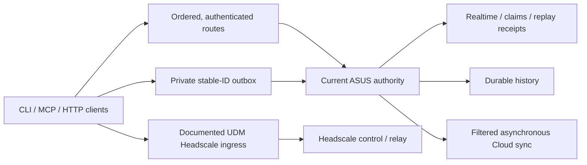

# Availability, recovery and off-site hosting

Assessment cutoff: 2026-10-16 UTC. This is a source-backed implementation and
hosting plan, not a deployment or high-availability acceptance receipt.
See [network routing](network-location-routing.md), [durable outbox](durable-outbox.md),
[cloud sync](cloud-sync.md), and [quality gates](QUALITY_GATES.md).

## Failure boundaries

The inspected client configuration has five authoritative routes to the same
logical hub, `asuspro13`. These routes tolerate individual path failures; they
all depend on the ASUS host and its stores. Cloudflare has a separate credential
space and message store and refuses authoritative claim mutations. A healthy
public Cloud endpoint does not establish authenticated fallback or replication.

The operations source in the related `headscale-ops` repository places
`headscale.dtmventures.com` behind the UDM's ingress. That is the documented
control endpoint. `vpn.dtmventures.com` is the MagicDNS base domain for nodes;
an absent public A record at that base name does not establish node DNS failure.
The deployment must be re-inventoried before changing either endpoint.

With an unreachable configured hub, ordinary remote reads must report offline
rather than silently present an independent local Redis instance as fleet
state. The durable outbox retains four supported write classes with stable IDs:
message, presence, acknowledgement and claim request. Queued claims are pending;
they do not grant ownership. Renew/release, direct channels and every other
operation must not be assumed to have the same offline support.

Current leases have expiration but no fencing epoch. PostgreSQL message history
alone cannot restore Redis claims and replay receipts. Two independent hubs
with the same identity would therefore be unsafe. Initial recovery should use
one writer and explicit, fenced promotion. Automatic promotion needs a tested
consistency/fencing design and a suitable independent quorum.

## Implementation queue and acceptance

Owners below describe responsibility, not a transfer of another lane's runtime.
Every regression uses owned disposable fixtures before a live failure drill.

| Priority / owner | Work | Required proof |
| --- | --- | --- |
| P1 / bus maintainer | Bound local Redis health across connection setup and commands | Silent/partial/trickled replies, auth/DB setup, current-thread and multi-thread runtime cancellation; actual MCP response and clean child/socket exit |
| P1 / bus maintainer | Prevent remote-configured CLI `watch`/`monitor` from observing a local island; add supported remote streaming | A local-backend sentinel is never contacted under remote configuration, online or offline; cursor/reconnect qualification for the remote implementation |
| P1 / HTTP maintainer | Remove SSE replay-before-consumer deadlock and close snapshot/subscription gap | 129 and 500 retained notifications yield bounded response headers, ordered replay, concurrent append delivery and disconnect cleanup |
| P1 / HTTP maintainer | Enforce maintenance pause for MCP mutations as well as REST/replay | Every mutation is rejected while paused without backend effects; discovery, reads and health remain available; resume restores dispatch |
| P1 / HTTP maintainer | Remove credential-bearing backend URI from discovery | Synthetic credentials never occur in discovery JSON or SSE-framed content |
| P2 / routing maintainer | Apply current location ordering to durable replay routes | Same authority, credentials, original configuration fingerprint and stable IDs; preserve 3-second per-route / 12-second aggregate replay budgets and pending work |
| P2 / routing maintainer | Include current locations in the long-lived MCP route cache | Mid-session network changes reselect an eligible route without waiting for the existing 15-second TTL; authority stays fixed |
| P2 / interface maintainer | Separate read-only diagnostics from automatic journal drain | Inspection performs no replay; pending/attempted/unknown state and sanitized per-route failure reasons are observable |
| P2 / interface maintainer | Reconcile CLI/MCP/HTTP/SSE documentation and actual wire contracts | Help, default ports, HTTP version flags, stateless MCP behavior, flat health fields and strict outbox-retirement conditions agree with executed fixtures |
| P2 / interface maintainer | Correct pool capacity metrics | Configured maximum, current total, idle and in-use are distinct |

The inspected named-remote MCP health path can drain retained writes before
probing health. Its replay and HTTP budgets remain separate from the local
Redis deadline. Do not advertise a whole-endpoint deadline or side-effect-free
inspection until those paths have their own detecting tests.

## Costed external placement

Public USD estimates checked at the assessment cutoff. They exclude taxes,
domain registration and operator time. Capacity is a pilot assumption requiring
measurement. Monthly Google examples use 730 hours and Iowa on-demand Linux.

| Candidate | Monthly estimate | Scope and limits |
| --- | ---: | --- |
| DigitalOcean Basic Regular, 2 GiB, 50 GiB disk, bundled IPv4/2,000 GiB transfer | $12; $14.40 with weekly backups | Small combined bus/Headscale pilot; memory/persistence load qualification required |
| Separate DigitalOcean 1 GiB Headscale and 2 GiB bus VMs | $18; $21.60 with weekly backups | Isolates service resource failures; same provider, no replicated bus failover |
| Google e2-small, 2 GiB + 20 GiB balanced disk + in-use IPv4 | About $17.88 before egress/backups | Compute $12.23 + disk $2 + IPv4 $3.65; actual region/account quote required |
| Google eligible free-tier e2-micro + eligible standard disk | About $3.65 for IPv4, conditional | Billing/allowance eligibility unverified; 1 GiB is not qualified for the complete bus stack |
| Cloudflare Workers Paid / Durable Objects | $5 account minimum plus usage | Existing edge application option; not a drop-in host for the native daemon stack or Headscale |

Sources: [DigitalOcean VM plans](https://www.digitalocean.com/pricing/droplets),
[backup pricing](https://docs.digitalocean.com/products/backups/details/pricing/),
[Google compute](https://cloud.google.com/products/compute/pricing/general-purpose),
[disk](https://cloud.google.com/compute/disks-image-pricing?hl=en),
[network/IP](https://cloud.google.com/vpc/network-pricing),
[free-tier conditions](https://docs.cloud.google.com/free/docs/free-cloud-features),
and [Workers pricing](https://developers.cloudflare.com/workers/platform/pricing/).
Relay egress can dominate VM cost; select and price the network tier explicitly.
The inspected Google project has no Compute VM to reuse. Billing inspection
returned `SERVICE_DISABLED`, so account funding/credits remain unverified.

Recommended next step: prepare the $14.40/month combined VPS pilot with an
upgrade path after measuring bus/Redis/PostgreSQL working set and traffic.
If isolation is the immediate priority, evaluate the $21.60 separated layout.
Neither is automatic HA. A second independent recovery host, state replication,
tested restoration and writer fencing are separate work and cost items.

## External control plane and forwarding

The new host must run the required writer/control services and persistent state
outside ASUS and the UDM. A public proxy that still forwards to ASUS preserves
the original failure dependency. Keep provider-console and direct-IP recovery
independent of the tailnet being repaired; keep a second tested management route.
Select which forwarding hostnames remain HTTP applications and which carry the
Headscale control protocol before changing DNS or Cloudflare bindings.

Headscale requires public HTTPS on TCP 443; embedded DERP also needs UDP 3478.
Its community-maintained [reverse proxy guidance](https://headscale.net/stable/ref/integration/reverse-proxy/)
reports Cloudflare Proxy/Tunnel incompatibility with the control protocol.
Use DNS-only control ingress/direct TLS or an explicitly qualified compatible
proxy. Verify exact releases; do not infer protocol support from ordinary HTTPS.
See [requirements](https://headscale.net/stable/setup/requirements/) and
[DERP operation](https://headscale.net/stable/ref/derp/).

Before cutover: preserve and restore-test Headscale identity/database/policy,
bus history, leases, replay receipts and cursors; define measured RPO/RTO; admit
one writer; retain rollback. Test fresh client registration, expired-key recovery,
existing peers, DERP-only paths and provider-console access with ASUS/UDM absent.
Keep alternative relay routes; replacing all relays with one VPS creates another
single failure dependency. No live outage drill or DNS cutover is performed by
this assessment.

## Drive-compatible archive candidate

The related `google-access` Rust tooling implements multipart/resumable upload
and file replacement, including explicit uncertain-completion handling. It does
not establish bus idempotency, a preallocated archive file ID, or compare-and-swap
updates. Google Cloud API enablement does not establish Workspace OAuth write
scope, target ownership or a valid selected token.

Build an asynchronous archive adapter for eligible, filtered message batches:

1. Preserve origin, message/client IDs and a versioned canonical batch digest.
2. Persist batch-ID-to-file-ID/hash progress locally before retrying uncertain
   uploads; reconcile an ambiguous response before creating another file.
3. Verify remote identity and readable content hash before retiring archive debt.
4. Apply bounded backoff and batching, preserving pending state on quota failure.
5. Rehearse download/restore, duplicate batches and lost upload responses.

Do not export secrets, raw client journals or `no-offsite` payloads. Archive
receipts must remain distinct from live bus delivery and ownership. Drive is an
archive candidate, not a transactional claims store. Existing Drive capacity and
this project's quota grandfathering remain unverified. Consult the current
[Drive API limits](https://developers.google.com/workspace/drive/api/guides/limits)
rather than historical request-count quotas.

## Current open gates

- Final-source health lint/build, normal hooked commit, review and exact-head CI.
- Compatible Linux artifact build and owning service rollout windows; ASUS CPU
  admission remains on hold while other lanes build.
- Independent Cloud desktop authentication provenance and read-quota recovery;
  a post-reset protected statistics request still failed before its handler.
- Reliability patches above; audits are source findings, not reproduced fixes.
- Provider/budget selection, current Headscale custody and restore rehearsal.
- Archive adapter contract, selected OAuth grants/target and restore acceptance.

No billable resources, DNS records, credentials or live service settings were
changed for this plan.
